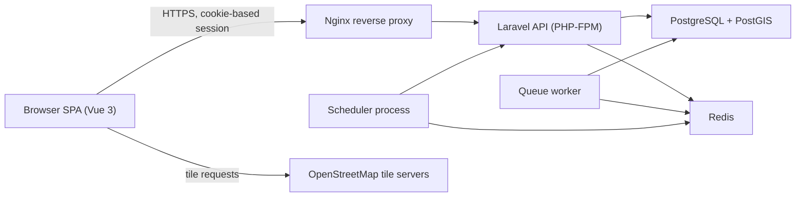
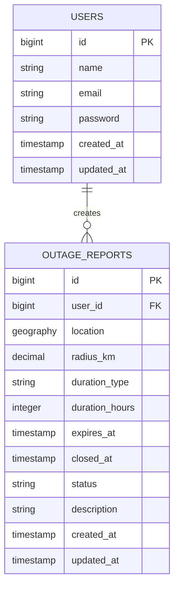

# ARCHITECTURE.md

Initial draft, written before infrastructure and application code. Refined incrementally as implementation decisions are confirmed; the ADRs are the part expected to stay stable.

## 1. System Diagram

All backend containers share one Laravel codebase and one image; `PhpFpm`, `Worker` and `Scheduler` are the same image running different entrypoints.

## 2. Data Model (ERD)

Indexes:
- `outage_reports.location` — GiST index (PostGIS `geography(Point, 4326)`), used by the bounding-box query.
- `outage_reports.status`, `outage_reports.expires_at` — composite index, used by the expiration job and by every "active reports" query.
- `outage_reports.user_id` — used by ownership checks and the "my reports" listing.

`status` is an application-level enum (`active`, `closed`, `expired`), never trusted alone for "is this currently visible" — every read also filters by `expires_at` to cover the gap between a report actually expiring and the scheduler marking it so.

## 3. API Contract Summary

| Method | Endpoint | Auth | Purpose |
|---|---|---|---|
| POST | `/api/v1/register` | none | Create account |
| POST | `/api/v1/login` | none | Start session |
| POST | `/api/v1/logout` | session | End session |
| GET | `/api/v1/me` | session | Current authenticated user |
| GET | `/api/v1/reports` | session | Paginated list of the caller's own reports |
| POST | `/api/v1/reports` | session | Create a report |
| PATCH | `/api/v1/reports/{report}` | session, owner | Edit radius, duration or description of an active report |
| POST | `/api/v1/reports/{report}/close` | session, owner | Close an active report manually |
| GET | `/api/v1/public/reports` | none | Active outages inside a bounding box, no personal data |

Full request/response schemas are published as an OpenAPI document once the endpoints are implemented, not duplicated here.

## 4. Architecture Decision Records

### ADR-1: Authentication strategy

**Decision:** Laravel Sanctum, SPA cookie-based session authentication, not API tokens.

**Why:** The client is a first-party SPA served from a domain the API trusts, not a third-party integration. Cookie-based sessions let the browser handle credential storage and CSRF protection through Sanctum's built-in flow, which removes an entire class of token-leakage risk (XSS exfiltrating a bearer token from local storage). Token auth would be the right call if a mobile app or external API consumer existed; neither is in scope.

**Trade-off:** Requires the SPA and API to share a parent domain (or be configured with `SESSION_DOMAIN` and CORS credentials) in production, which is documented in the deployment section of the README.

### ADR-2: Database choice and geographic querying

**Decision:** PostgreSQL with the PostGIS extension, `geography(Point, 4326)` column for report location, GiST spatial index.

**Why:** The core query pattern is "find all active reports whose point falls inside this bounding box," which is exactly what spatial indexing exists for. Computing bounding-box membership with plain latitude/longitude range filters works but does not scale as well and does not extend cleanly if radius-based intersection queries are needed later (e.g., "does this new report overlap an existing one," relevant to ADR-4). PostGIS's `ST_MakeEnvelope` and `&&` operator push the filtering into the database and the index, instead of filtering in PHP.

**Trade-off:** Adds an extension dependency to the database image and to any evaluator's local setup; mitigated by using the official `postgis/postgis` Docker image, so no manual extension installation is required.

`location` is nullable at the schema level, not `NOT NULL`, because Eloquent's mass-assignment cannot express a PostGIS point literal in a single bound `INSERT`; every report is created through `OutageReport::createWithCoordinates()`, which inserts the row and immediately sets `location` inside the same database transaction, so a row is never readable with a null location in practice. The alternative (a single raw parameterized `INSERT ... RETURNING id` with the point expression inlined) was considered and rejected for this stage to keep report creation going through ordinary Eloquent `create()`, which the rest of the codebase (factories, tests) can reuse without duplicating raw SQL.

### ADR-3: Report expiration strategy

**Decision:** Expiration is enforced in two independent places: a scheduled job that periodically flips `active` reports past their `expires_at` to `expired`, and every query that reads "active" reports additionally filters by `expires_at > now()` regardless of the stored `status`.

**Why:** The brief explicitly requires that an expired report must never appear as active "even if the scheduler is delayed." Relying on the job alone creates exactly that window. Filtering by computed expiry at read time makes the displayed state correct independent of job timing; the job's role is to keep the stored `status` eventually consistent for listings and historical queries, not to be the sole source of truth for "is this active."

**Trade-off:** Two places to keep in sync. Mitigated by computing `expires_at` once at creation time (fixed duration: `created_at + duration_hours`; "until closed": `created_at + 72h`) and never recomputing it elsewhere, so there is a single stored value both paths read.

### ADR-4: Duplicate reports handling

**Decision:** No automatic merging or deduplication. Overlapping reports from different users are stored and displayed independently, each as its own circle on the map.

**Why:** Automatic merging requires a definition of "same outage" (distance threshold, time window, radius overlap) that is itself a product decision with no clearly correct default, and an incorrect merge silently hides a real, distinct outage. Given the mandatory scope and time budget, the lower-risk choice is to let overlapping circles render as-is: the map visually communicates "several people reported outages here," which is useful information on its own, without the system making a merging judgment call it cannot fully justify.

**Trade-off:** The public map can look visually noisy in a widespread outage with many overlapping reports. This is explicitly accepted here and is the natural seam for bonus feature B2 (community confirmation), which would be the correct foundation for deduplication later rather than a heuristic bolted on now.

### ADR-5: Map provider choice and key protection

**Decision:** OpenStreetMap tiles rendered through Leaflet, not Google Maps.

**Why:** The brief requires evaluators to run the project without paying for anything; OSM tiles need no API key and no billing account at all, which removes a setup failure mode entirely rather than mitigating it. The map is accessed only behind a single adapter component (`MapAdapter`), so the rest of the frontend depends on a small internal interface (render point, render circle, emit point-selected, emit radius-changed), never on Leaflet's API directly. Swapping to Google Maps later means rewriting the adapter's internals only.

**Trade-off:** No key-based tile usage limits to reason about, but also no built-in geocoding; if reverse geocoding (bonus B8) is implemented, it uses a separate free service (e.g., Nominatim), chosen and documented at that point.

### ADR-6: Frontend framework and state management

**Decision:** Vue 3 with the Composition API, Pinia for state, Vue Router for navigation.

**Why:** Pinia is the current standard state store for Vue 3, with first-class TypeScript inference and no boilerplate module structure to maintain. The app's state surface is small (current user, report list, map viewport) and does not need Vuex-style modules. A single HTTP service layer (not components) owns all API calls, so state stores consume a service, not `fetch` directly.

**Trade-off:** None material at this scope; the alternative (React) was equally viable and is not used here because Vue's template syntax keeps the map-heavy views (DOM-adjacent, imperative Leaflet calls inside a Vue component) easier to reason about than JSX for this particular UI.

## 5. Security Considerations

- All report mutation endpoints are authorized through Laravel Policies, checked against the authenticated user, never against a client-supplied user id.
- The public outages endpoint is served by a dedicated API Resource that whitelists fields; it is structurally impossible for it to leak `user_id`, name or email, because those fields are never read into that resource in the first place.
- Rate limiting is applied per authenticated user (report creation) and per IP (authentication endpoints), using Laravel's rate limiter backed by Redis, with limits configurable through environment variables rather than hardcoded.
- All input (coordinates, radius, duration, description) is validated through Form Requests with explicit ranges; nothing reaches Eloquent unvalidated.
- No secrets are committed; every service reads configuration from environment variables, and `.env.example` files enumerate every required variable with safe placeholder values.
- Containers run application processes as a non-root user where the base image supports it.

## 6. Scalability Considerations

At the scale described in the brief (100,000 active users during a city-wide blackout), the parts of this design that would need to change first:

- The public outages endpoint would move from polling to a push model (bonus B1, WebSockets via Laravel Reverb), since polling from 100,000 clients multiplies read load linearly with client count regardless of how cheap each individual query is.
- Redis and the database would need to be split from single-container services into managed, replicated services; the current docker-compose topology is explicitly a development/evaluation setup, not a production topology.
- The bounding-box query, already indexed, would benefit from a read-replica for public (unauthenticated) traffic, isolating it from the write path used by report creation.
- Rate limiting and session storage already live in Redis, so horizontally scaling the PHP-FPM tier behind the load balancer requires no state migration.
